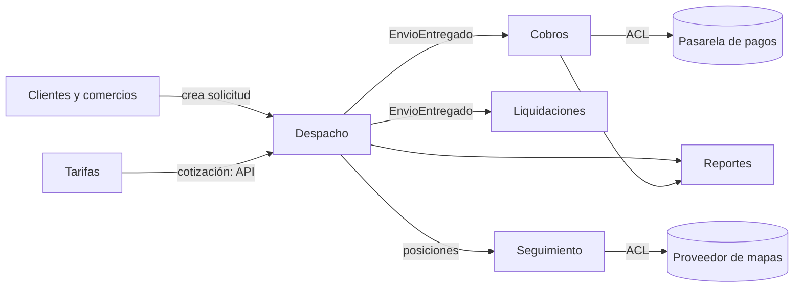
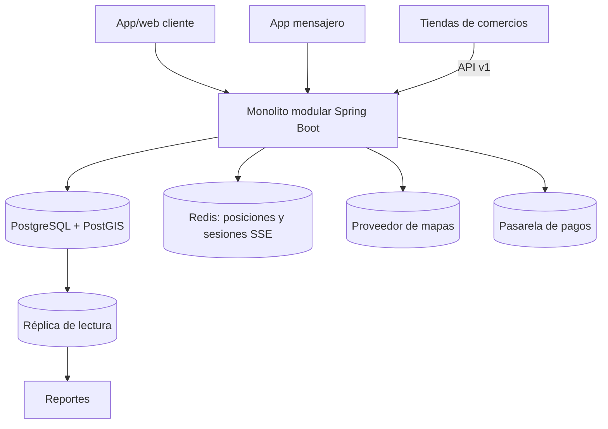

# Taller integrador de arquitectura — Mensajería urbana (solución)

Código del núcleo en `src/main/java/mensajeria/despacho` (Java puro). `mvn test` ejecuta 7 pruebas: cotización, ciclo de estados, asignación al más cercano compatible, capacidad, rechazo del mensajero, **asignaciones concurrentes** (8 hilos compiten por un mensajero y solo una gana) y una regla de ArchUnit que impide dependencias externas en el núcleo.

## 1. Atributos de calidad (en orden)

| # | Atributo | Por qué en ese lugar | Escenario medible |
|---|---|---|---|
| 1 | **Corrección del despacho** | Asignar dos envíos incompatibles o perder uno rompe la promesa del negocio | Con 50 asignaciones simultáneas sobre 10 mensajeros, ningún mensajero supera su capacidad en franjas solapadas (probado en `asignacionesConcurrentesNoSuperanLaCapacidad`) |
| 2 | **Disponibilidad de la toma de pedidos y la app del mensajero** | Si no se puede pedir, el cliente se va a la competencia | 99,5 % mensual en horario 6:00–22:00; una caída del proveedor de mapas no impide crear envíos |
| 3 | **Escalabilidad al pico** | Diciembre multiplica por cinco (10.000 envíos/día, unos 25 por minuto en hora pico) | Con 500 cotizaciones simultáneas, p95 < 300 ms; asignación en < 5 s desde la solicitud en el p95 |
| 4 | **Facilidad de cambio** | Tarifas, reglas de asignación y expansión a ciudades cambian cada mes | Una nueva regla de tarifa o una ciudad nueva se publica en ≤ 2 días sin tocar otros módulos |
| 5 | **Costo** | Presupuesto limitado | Infraestructura ≤ USD 600/mes en lanzamiento; crecer al pico sin duplicar el costo fijo |

Seguridad y privacidad (datos de ubicación) se tratan como requisito, no como atributo a optimizar: cifrado en tránsito, retención de ubicaciones de 30 días.

## 2. Diseño estratégico

### Glosario

| Término | Definición |
|---|---|
| Solicitud de envío | Pedido de un cliente con origen, destino, tamaño y franja |
| Envío | Solicitud aceptada y cotizada, con estado |
| Cotización | Precio calculado antes de confirmar; vigente 15 minutos |
| Franja | Intervalo en que el cliente quiere la recogida |
| Tarifa negociada | Descuento pactado con un comercio |
| Mensajero | Persona que recoge y entrega, con vehículo y capacidad |
| Capacidad | Volumen (litros) que el mensajero lleva a la vez |
| Asignación | Oferta de un envío a un mensajero; puede aceptarla o rechazarla |
| Recogida | Momento en que el mensajero tiene el paquete |
| Ruta | Trayecto en curso hacia el destino |
| Entrega | Paquete recibido en destino, con evidencia (foto o código) |
| Entrega fallida | Intento sin éxito (destinatario ausente, dirección errada) |
| Liquidación | Pago semanal al mensajero por sus entregas |
| Cobro | Cargo al cliente al entregar |
| Zona | Área de la ciudad para tarifas y búsqueda de mensajeros |
| Comercio integrado | Cliente que crea envíos por API |

### Contextos y mapa

Capas anticorrupción frente al proveedor de mapas (geocodificación, distancias) y frente a la pasarela de pagos.

### Subdominios

| Subdominio | Tipo | Decisión |
|---|---|---|
| Despacho (asignación y estados) | Núcleo | Construir con el mejor diseño |
| Tarifas | Núcleo/soporte | Construir; reglas configurables |
| Seguimiento en mapa | Soporte | Construir sobre el proveedor de mapas |
| Liquidaciones | Soporte | Construir simple (proceso por lotes semanal) |
| Cobros | Genérico | Comprar: pasarela externa |
| Mapas y rutas | Genérico | Comprar: proveedor externo |
| Identidad y acceso | Genérico | Comprar: Keycloak o Cognito |
| Reportes | Soporte | Herramienta de BI sobre réplica |

## 3. Arquitectura

**Lanzamiento: monolito modular.** 7 desarrolladores son un equipo; las fronteras del dominio todavía se están descubriendo. **Año siguiente:** se mantiene el monolito y se replica por ciudad (despliegue por ciudad o particionado por `ciudad_id`). Condiciones para extraer servicios: que `seguimiento` necesite escalar aparte (muchas conexiones abiertas), o que se formen equipos separados por subdominio.

| Módulo | Responsabilidad | API pública | Datos propios | Interior |
|---|---|---|---|---|
| `despacho` | Envíos, estados, asignación | `DespachoApi`, eventos `EnvioSolicitado`, `EnvioAsignado`, `EnvioEntregado`, `EnvioFallido` | envíos, mensajeros, asignaciones | Hexágono (implementado) |
| `tarifas` | Cotizar | `TarifasApi.cotizar` | tarifas, acuerdos con comercios | Dominio simple + reglas en tabla |
| `clientes` | Personas, comercios, credenciales de API | `ClientesApi` | clientes, comercios | CRUD en capas |
| `seguimiento` | Posiciones y difusión al cliente | `SeguimientoApi`, WebSocket/SSE | posiciones (TTL) | Adaptadores + caché |
| `cobros` | Cobrar al entregar, reintentos | evento `CobroFallido` | cobros, intentos | Hexágono pequeño (pasarela como puerto) |
| `liquidaciones` | Liquidación semanal | `LiquidacionesApi` | liquidaciones | Proceso por lotes |
| `reportes` | Operación y facturación | consultas | proyecciones propias | CQRS de lectura |

**Comunicación:** síncrono para cotizar (el cliente espera el precio) y para consultar estado; eventos para todo lo que es consecuencia: cobrar al entregar, liquidar, actualizar reportes, notificar.

### Contenedores

## 4. Decisiones difíciles

1. **Dos envíos incompatibles al mismo mensajero.** Bloqueo optimista sobre el agregado `Mensajero` (columna `version`, `UPDATE ... WHERE version = ?`) y reintento de la asignación con datos frescos. Implementado y probado con 8 hilos. *Descartado:* bloqueo pesimista (`SELECT ... FOR UPDATE`) sobre todos los mensajeros cercanos, que serializa el despacho en hora pico; y un despachador de un solo hilo, que es un cuello de botella y un punto único de fallo.
2. **Entrega registrada, cobro fallido.** La entrega es un hecho y no se revierte. `cobros` reacciona a `EnvioEntregado` (outbox), reintenta con espera creciente, y si falla queda en `CobroPendiente`: el cliente no puede crear nuevos envíos hasta pagar y el mensajero se liquida igual. *Descartado:* transacción que una entrega y cobro, porque la pasarela es externa y la entrega no se puede deshacer.
3. **Mapa del cliente.** La app del mensajero envía su posición cada 10 s (cada 30 s si está detenido); el servidor guarda la última en Redis con TTL y la difunde por **Server-Sent Events** solo a quien sigue ese envío. *Descartado:* consulta periódica del cliente cada segundo (carga inútil) y WebSocket bidireccional (no hace falta enviar desde el cliente).
4. **Caída del proveedor de mapas.** Puerto `Distancias` con cortacircuitos y alternativa: distancia en línea recta × 1,3 para cotizar; caché de geocodificación por dirección; segundo proveedor configurable. El seguimiento muestra la última posición sin mapa de fondo. *Descartado:* depender de él para crear envíos.
5. **Reportes sin afectar la operación.** Réplica de lectura y proyecciones propias del módulo `reportes`. *Descartado:* consultas pesadas contra la base principal en horario.
6. **Versionado de la API de comercios.** Versión en la ruta (`/v1/`), cambios solo aditivos dentro de una versión, `v2` paralela con 6 meses de convivencia, cabecera `Deprecation`/`Sunset` y pruebas de contrato por comercio grande. *Descartado:* versionar por cabecera (más difícil de depurar para integradores pequeños).

## 5. Tres ADR

### ADR-001 — Monolito modular para el lanzamiento
- **Contexto:** 7 desarrolladores, 4 meses, presupuesto limitado, dominio nuevo.
- **Decisión:** un monolito Spring Boot con módulos verificados por Spring Modulith y una base PostgreSQL con esquema por módulo.
- **Alternativas:** microservicios por contexto (descartada: costo operativo y equipo único); monolito en capas sin módulos (descartada: imposible extraer después).
- **Consecuencias +:** un despliegue, transacciones locales, refactor barato de fronteras. **−:** escalado conjunto; disciplina para no compartir tablas; un fallo grave tumba todo.

### ADR-002 — Bloqueo optimista para la asignación
- **Contexto:** varias solicitudes compiten por los mismos mensajeros cercanos en hora pico.
- **Decisión:** versión en `Mensajero`, verificación al guardar y hasta 3 reintentos con datos frescos.
- **Alternativas:** `SELECT FOR UPDATE` (serializa); cola única de despacho (cuello de botella); restricción en base de datos sobre capacidad (difícil de expresar con franjas solapadas).
- **Consecuencias +:** sin bloqueos largos, correcto bajo concurrencia (probado). **−:** reintentos en picos de contención; hay que medir la tasa de conflictos.

### ADR-003 — Eventos con outbox entre despacho, cobros y liquidaciones
- **Contexto:** al entregar hay que cobrar, liquidar y actualizar reportes; la entrega no puede fallar por un problema en cobros.
- **Decisión:** `EnvioEntregado` se guarda en la tabla de publicación de eventos en la misma transacción (registro de Spring Modulith) y se procesa de forma asíncrona y reintentable.
- **Alternativas:** llamadas síncronas (acoplan la entrega a la pasarela); Kafka desde el día 1 (operación costosa para el volumen inicial).
- **Consecuencias +:** entrega confiable "al menos una vez", módulos desacoplados, camino natural a un broker. **−:** consumidores idempotentes obligatorios; consistencia eventual visible en reportes.

## 6. Código

Módulo `despacho` en Java puro:

- Dominio: `Envio` (máquina de estados con transiciones válidas), `Mensajero` (compatibilidad por capacidad y franjas, versión), `Cotizador` (distancia, tamaño, hora pico, tarifa negociada con `sealed` + `switch`), `Franja`, `Punto`, `Tamano`.
- Aplicación: `SolicitarEnvio`, `AsignarMensajero` (más cercano compatible, reintento ante conflicto); puertos `Envios`, `Mensajeros`, `Notificaciones`.
- Adaptadores en memoria que se comportan como una base (cada lectura es un objeto nuevo; guardar compara versión).

## 7. Plan y riesgos

| Mes | Entrega |
|---|---|
| 1 | Despacho y tarifas (núcleo), API interna, app del mensajero mínima (aceptar, recoger, entregar) |
| 2 | Clientes, API de comercios v1, cobro al entregar con la pasarela, seguimiento básico |
| 3 | Seguimiento en mapa (SSE), liquidaciones, reportes sobre réplica, observabilidad |
| 4 | Pruebas de carga al 5x, endurecimiento, piloto con 3 comercios, lanzamiento |

**Riesgos:** (1) contención en asignación en pico → prueba de carga en el mes 3 y métrica de conflictos; (2) dependencia del proveedor de mapas → puerto, caché y alternativa en línea recta; (3) calidad de la app móvil con mala conectividad → cola local de eventos en la app y operaciones idempotentes.

**Fuera del lanzamiento:** rutas óptimas multi-parada, predicción de demanda, multi-ciudad, facturación electrónica propia (se usa la del proveedor), reprogramación automática de entregas fallidas.

## 8. Defensa

1. *"El bloqueo optimista va a colapsar en diciembre: todos compiten por los mismos 5 mensajeros del centro."* — Los conflictos solo ocurren entre asignaciones al **mismo** mensajero en el mismo instante; con 25 solicitudes por minuto en pico la probabilidad es baja, y al fallar se reintenta con otro candidato. Se medirá la tasa de conflictos y, si supera el 5 %, se pasa a asignación por lotes cada 2 segundos por zona.
2. *"Un monolito no va a escalar a tres ciudades."* — Las ciudades no comparten operación: se despliega una instancia por ciudad (o se particiona por `ciudad_id`). El volumen previsto (10.000 envíos diarios en pico) está muy por debajo de lo que soporta un monolito en dos réplicas.
3. *"Eventos dentro del monolito son complejidad innecesaria."* — Sin ellos, la entrega depende de la pasarela externa en la misma transacción. El registro de publicación de Spring Modulith cuesta una tabla y da reintentos y trazabilidad; es la opción más barata que no pierde cobros.
