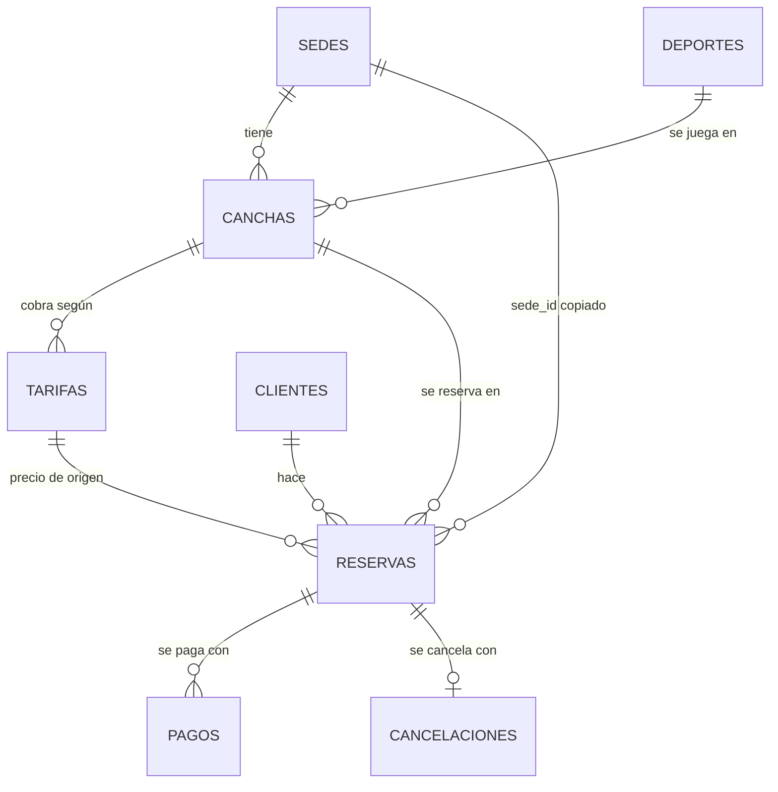

# Análisis — n8-01 Modelado relacional (reservas de canchas)

Se ejecuta con `mvn verify` desde esta carpeta, contra PostgreSQL 18.7 (puerto 43432, `docker compose up -d --wait`).

- DDL: `src/main/resources/esquema.sql`.
- `EsquemaTest`: 9 pruebas que disparan cada restricción en la base real y comprueban el SQLSTATE (23P01 exclusión, 23503 clave foránea, 23514 CHECK, 23505 único).
- `MapeoJpaTest`: Hibernate 7.4.5 valida las dos entidades contra el DDL (`ddl-auto=validate`) y comprueba que la regla de solapamiento solo la conoce la base.

## 1. Diagrama entidad-relación

## 2. Restricciones

| Regla | Cómo se garantiza | Prueba |
|---|---|---|
| Dos reservas de la misma cancha no se solapan | `EXCLUDE USING gist (cancha_id WITH =, tstzrange(inicio, fin, '[)') WITH &&) WHERE (estado <> 'CANCELADA')` (extensión `btree_gist`) | `dos_reservas_..._se_rechazan`, también con la misma franja escrita en otra zona horaria |
| Franjas contiguas permitidas (19:00 termina, 19:00 empieza) | Rango semiabierto `[)` | `franjas_contiguas_...` |
| Cancelar libera la franja | El `WHERE` parcial de la exclusión | `una_reserva_cancelada_libera_la_franja` |
| Dos tarifas de la misma cancha no se pisan en día, horario y vigencia | Exclusión con `tsrange` del horario y `daterange` de la vigencia | `tarifas_que_se_pisan_...` |
| La sede copiada coincide con la de la cancha | Clave foránea compuesta `(cancha_id, sede_id) → canchas(id, sede_id)` | `la_sede_copiada_no_puede_contradecir_a_la_cancha` |
| Un pago de la pasarela no se registra dos veces | `UNIQUE (referencia)` | `pagos_y_cancelaciones_no_se_duplican` |
| Una reserva se cancela una sola vez | Clave primaria de `cancelaciones` = `reserva_id` | Ídem |
| Correo único sin importar mayúsculas | Índice único sobre `lower(correo)` | `restricciones_de_dominio` |
| Estados, montos, fin posterior al inicio | `CHECK` | `restricciones_de_dominio` |

Una comprobación previa con `SELECT` no basta para impedir el solapamiento: dos peticiones simultáneas la pasan a la vez. La exclusión la evalúa la base al insertar, también con concurrencia.

## 3. Valores copiados a propósito para conservar la historia

- `reservas.precio_total`: el precio acordado al reservar. La tarifa puede cambiar después sin alterar lo pactado. Lo comprueba `el_precio_copiado_conserva_la_historia_cuando_cambia_la_tarifa`. Se guarda también `tarifa_id` para saber de qué tarifa salió.
- `cancelaciones.porcentaje_reembolso` y `monto_reembolso`: la política de reembolso vigente al cancelar. Si mañana la política cambia, el reembolso de ayer no cambia.
- `pagos.monto` y `pagos.referencia`: lo que la pasarela confirmó, no lo que la reserva dice hoy.
- Las tarifas tienen vigencia (`vigente_desde`, `vigente_hasta`). Un cambio de precio cierra la tarifa anterior y abre una nueva; no se sobrescribe.

## 4. Una desnormalización con evidencia

`reservas.sede_id` repite la sede de la cancha. La consulta más frecuente del sistema es la agenda diaria de una sede: "todas las reservas de la sede X entre las 00:00 y las 23:59". Con `sede_id` en la reserva basta un índice `(sede_id, inicio)` y no hay que unir con `canchas`.

La evidencia que exigiría antes de hacerlo en un sistema real: que la consulta aparezca entre las primeras de `pg_stat_statements` por tiempo total, y que su plan con la unión (`Nested Loop` o `Hash Join` sobre `canchas`) sea el costo dominante. El riesgo de la copia (una sede que contradiga a la cancha) se elimina con la clave foránea compuesta: la base rechaza la incoherencia (23503).

## 5. Mapeo JPA y dónde no encajan los modelos

Entidades `Cancha` y `Reserva` en `src/main/java/reservas/jpa`. Hibernate las valida contra el DDL con `ddl-auto=validate`.

1. **Rangos y exclusión.** La regla central del dominio ("no se solapan") se expresa con `tstzrange` y una restricción de exclusión. JPA solo ve dos `Instant`. La regla no existe en el modelo de objetos: el conflicto aparece al hacer `flush`, como `ConstraintViolationException` de Hibernate. Sin un `@Repository` de Spring de por medio no se traduce a `DataIntegrityViolationException`; la prueba lo muestra.
2. **El dato repetido.** `Reserva` tiene `cancha` (relación) y `sedeId` (copia). En objetos sería redundante; en la base es una decisión con clave foránea compuesta, que JPA no puede expresar.
3. **Identidad.** Una `Cancha` en memoria es un objeto; en la base, una fila con `id` generado (`IDENTITY`). Antes del `persist` no tiene identidad, y `equals` por `id` falla con objetos nuevos.
4. **Navegación frente a consulta.** `reserva.getCancha().getSede()` sugiere recorrer objetos; en la base, cada salto es una consulta o una unión (el problema N+1 si no se planifica).
5. **Restricciones `CHECK` y enum.** `@Enumerated(STRING)` y el `CHECK (estado IN …)` son dos listas que hay que mantener iguales a mano.
