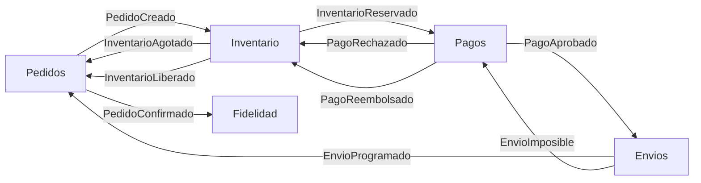

# Sagas 03 — La misma saga por coreografía

Código: un paquete por servicio en `src/main/java/tienda/` (`pedidos`, `inventario`, `pagos`, `envios`, `fidelidad`) y el bus en `bus/`. Ningún servicio importa a otro: solo `tienda.bus`. Pruebas: `CoreografiaTest` (8). `java -cp target/classes tienda.Main` (tras `mvn test`) imprime en la consola la traza de los cuatro caminos.

## 1. Eventos y grafo

| Servicio | Publica | Reacciona a |
|---|---|---|
| Pedidos | `PedidoCreado`, `PedidoConfirmado`, `PedidoCancelado` | `EnvioProgramado` (confirma), `InventarioAgotado` y `InventarioLiberado` (cancela) |
| Inventario | `InventarioReservado`, `InventarioAgotado`, `InventarioLiberado` | `PedidoCreado` (reserva), `PagoRechazado` y `PagoReembolsado` (libera) |
| Pagos | `PagoAprobado`, `PagoRechazado`, `PagoReembolsado` | `InventarioReservado` (cobra), `EnvioImposible` (reembolsa) |
| Envíos | `EnvioProgramado`, `EnvioImposible` | `PagoAprobado` |
| Fidelidad | — | `PedidoConfirmado` |



## 2. Los cuatro caminos (salida real de `Main`)

```
c-1: [PedidoCreado, InventarioReservado, PagoAprobado, EnvioProgramado, PedidoConfirmado]
c-2: [PedidoCreado, InventarioReservado, PagoRechazado, InventarioLiberado, PedidoCancelado]
c-3: [PedidoCreado, InventarioAgotado, PedidoCancelado]
c-4: [PedidoCreado, InventarioReservado, PagoAprobado, EnvioImposible, PagoReembolsado, InventarioLiberado, PedidoCancelado]
pedidos={c-1=CONFIRMADO, c-2=CANCELADO, c-3=CANCELADO, c-4=CANCELADO} existencias=1 reservas=[c-1] cobros=[c-1] reembolsos=[c-4] despachos=[c-1] puntos=[c-1]
inconsistencias: []
```

## 3 a 5. Comparación con la versión orquestada (sesión 02)

Conteos hechos sobre el código (`grep -l 'suscribir('` y `grep -l cobrarPrimero` en esta solución; `Transiciones.java` en la de la sesión 02):

| Pregunta | Orquestada (02) | Coreografiada (03) |
|---|---|---|
| ¿En cuántos archivos está el flujo? | **1** (`Transiciones.java`) | **5** (cada servicio con sus suscripciones) |
| ¿Cuántos hay que abrir para explicar "pago rechazado"? | **1**: la fila `COBRANDO + pago-rechazado → LIBERANDO` y la siguiente | **3**: `Pagos` (publica `PagoRechazado`), `Inventario` (lo escucha y libera), `Pedidos` (escucha `InventarioLiberado` y cancela) |
| Añadir fidelidad: servicios existentes tocados | 1 archivo del orquestador (tabla) + `Estado` + participante nuevo | **0** existentes: `Fidelidad` solo se suscribe a `PedidoConfirmado` (prueba `fidelidadSoloEscucha`) |
| Cobrar antes de reservar: servicios tocados | 1 (`Transiciones`: cambian filas; las órdenes de los participantes no cambian) | **4**: `Pedidos`, `Inventario`, `Pagos`, `Envios` (los cuatro llevan la bandera `cobrarPrimero`, porque cambia a qué evento reacciona cada uno). Ejecutado: `losCaminosConLosDosOrdenes[true]` y `sinExistencias[true]` |

El cambio de orden en la versión orquestada no se implementó: el "1" sale de leer el código, porque las órdenes y respuestas de cada participante no dependen del orden. En la coreografía sí se implementó, y además mostró el costo de negocio: con el cobro primero, un pedido sin existencias deja un cobro y un reembolso (`sinExistencias[true]` espera `reembolsos=[agotado]`).

La coreografía gana al **añadir oyentes** (cero servicios tocados) y pierde al **cambiar el flujo** (cuatro servicios y un despliegue coordinado).

## 6. Un servicio caído

`unServicioCaidoSoloSeDetectaPorTiempo`: Envíos no reacciona a `PagoAprobado`. **No aparece ningún error**: no hay excepción, el bus no descarta nada, todos los servicios están "bien". El pedido se queda `PENDIENTE` con cobro y reserva.

Mecanismo: `Pedidos.atascados(cicloActual, ciclos)` lista los pedidos `PENDIENTE` más viejos que un umbral. **Dueño: Pedidos**, porque es el dueño del resultado de la compra y quien responde al cliente. En producción: una tarea programada en Pedidos que consulta su propia tabla y emite una métrica "pedidos pendientes más de N minutos" con alerta, y un manual que diga qué hacer (consultar la traza del paso 8 para saber en qué paso se quedó).

## 7. Ciclo accidental

`unCicloAccidentalSeCorta` suscribe dos reacciones mal pensadas: `PedidoConfirmado → InventarioAjustado` y `InventarioAjustado → PedidoConfirmado`. Sin defensa, el bus no terminaría nunca (cada evento genera otro). Defensa: cada evento lleva `profundidad` = la de su causa + 1 (el bus la calcula al publicar "causado por"); por encima de `PROFUNDIDAD_MAXIMA = 10` el evento se aparta a `descartados` en lugar de entregarse. Resultado ejecutado: el bus termina tras 11 entregas y hay exactamente 1 descartado con profundidad 11. El flujo legítimo más largo de la tienda (`c-4`) tiene profundidad 6. En producción el descarte iría a un tema de fallidos con alerta.

## 8. Reconstrucción desde la traza

`Reconstruccion.estado(traza, correlacion)` recorre los eventos de una correlación y deduce el estado: `CONFIRMADA`, `CANCELADA` o `EN CURSO (reservado/sin reserva, cobrado/sin cobro)`. Probado para una confirmada, una cancelada por envío y una atascada (`EN CURSO (reservado, cobrado)`).

Qué tan fiable es: tanto como la traza. Supone que **todo** evento se registró, en orden y con su correlación. Un evento perdido (o uno publicado sin correlación) da un estado falso sin avisar; con varias particiones el orden entre temas no está garantizado y el pliegue puede ver `PagoReembolsado` antes que `PagoAprobado`. Sirve para diagnóstico, no como fuente de verdad: la verdad está en las bases de cada servicio.

## 9. Versión híbrida para la tienda

| Parte | Cómo | Por qué | Costo aceptado |
|---|---|---|---|
| Reservar, cobrar, programar envío y sus compensaciones | **Orquestada** (orquestador en Pedidos) | Es el núcleo con compensaciones y orden que importa; cambiar el orden debe ser editar una tabla, y "¿en qué paso va la compra 42?" debe responderse leyendo una fila | Un componente más que operar y que puede ser cuello de botella; los participantes reciben órdenes (acoplamiento a la forma de la orden) |
| Notificaciones, puntos de fidelidad, analítica | **Coreografía** sobre `PedidoConfirmado` / `PedidoCancelado` | Son reacciones laterales sin compensación: añadirlas o quitarlas no debe tocar la saga | Nadie vigila si Fidelidad dejó de escuchar: necesita su propia alerta de retraso de consumidor |
| Vigilancia de compras atascadas | En Pedidos (que ya es el orquestador) | Un solo dueño del resultado | — |
