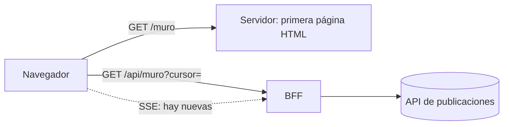
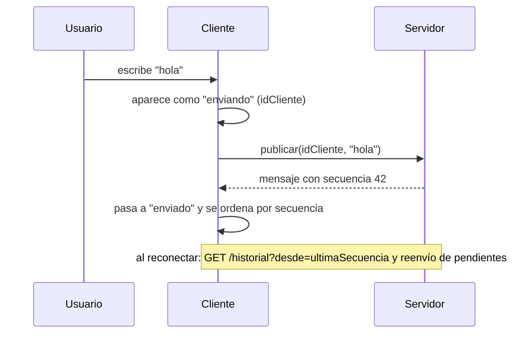
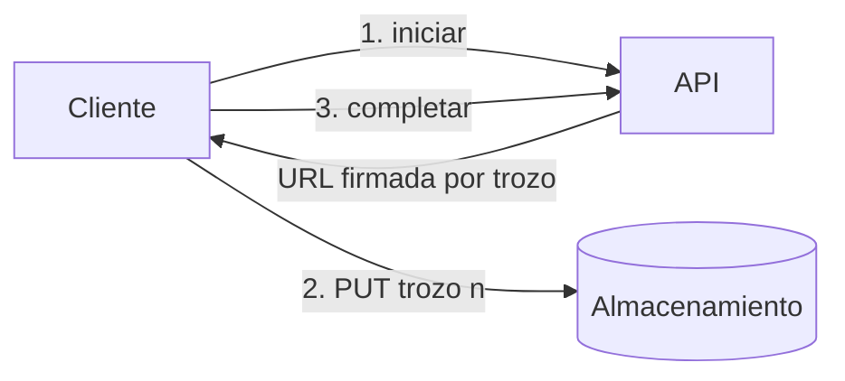

# Diseño de sistemas frontend: tres problemas clásicos

Método de la sesión aplicado a tres problemas. El chat (problema 2) está implementado en `chat.ts` y se prueba en `taller.test.ts`.

# Problema 1: muro de noticias con desplazamiento infinito

## Requisitos y fuera de alcance
- Funcionales: leer el muro de arriba abajo, cargar más al llegar al final, ver un aviso "N publicaciones nuevas" sin que la lista salte, abrir una publicación y volver al mismo punto.
- No funcionales: móvil con 3G, lector de pantalla y teclado, hasta 50.000 elementos acumulados en una sesión larga, SEO solo de la primera página, 2 equipos.
- Fuera de alcance: publicar, comentar, mensajes directos y moderación.

## Arquitectura
Primera página renderizada en servidor (SEO y contenido rápido); el resto, en cliente por cursor. Lista virtual para que el DOM no crezca.

## Modelo de datos y contrato
`GET /api/muro?cursor=<opaco>&limite=20` devuelve `{ items: Publicacion[], siguiente: string | null }` y `GET /api/muro/nuevas?desde=<id>` devuelve solo el conteo. `Publicacion = { id, autor, texto, creadaEn, imagen? }`. El cursor es opaco y basado en la clave de orden, no en un desplazamiento: insertar publicaciones nuevas no repite ni salta elementos.

## Clasificación del estado
| Dato | Dónde vive |
|---|---|
| Publicaciones cargadas y cursor | Servidor, en la caché de consultas del cliente |
| Filtro de tema | URL |
| Posición de desplazamiento | Local, restaurada desde el historial |
| "Hay nuevas" | Local, alimentado por SSE |
| Publicación abierta | URL |

## Árbol de componentes
`PaginaMuro` (contenedor: URL y datos) > `AvisoDeNuevas`, `ListaVirtual` > `Tarjeta` (presentación), `Centinela` (dispara la siguiente página), `EstadoVacioOError`.

## Cinco decisiones
| # | Decisión | Elegido | Alternativa | Por qué |
|---|---|---|---|---|
| 1 | Paginación | Cursor opaco | Desplazamiento (offset) | Con inserciones el offset repite o salta elementos |
| 2 | Pintado | Lista virtual con altura estimada | Pintar todo | Con 50.000 elementos el DOM y la memoria son inviables |
| 3 | Elementos nuevos | Aviso que el usuario acepta | Insertar arriba al llegar | Insertar mueve lo que el usuario está leyendo |
| 4 | Caché | Por página y cursor, con vida corta | Sin caché | Volver desde una publicación debe ser instantáneo |
| 5 | Accesibilidad | Botón "Cargar más" además del centinela, región con `aria-live` educada | Solo desplazamiento automático | Teclado y lector de pantalla no alcanzan el pie |

## Modos de fallo
- Sin red: se muestran las páginas ya cargadas y una barra "Sin conexión" con reintento; no se vacía la lista.
- Error al pedir la siguiente página: fila final con "No se pudo cargar. Reintentar"; el cursor no avanza.
- Datos parciales (imagen que no carga): marcador de posición con el alto reservado, para no mover el contenido.
- Lista vacía: estado vacío explícito, distinto del error.

# Problema 2: chat

## Requisitos y fuera de alcance
- Funcionales: enviar y recibir mensajes de una sala en tiempo real, ver el historial, saber si un mensaje se envió o falló, reintentar.
- No funcionales: redes móviles inestables, orden idéntico para todos los participantes, accesible, 1 equipo.
- Fuera de alcance: cifrado de extremo a extremo, archivos adjuntos, llamadas.

## Arquitectura
Cliente con WebSocket (con reconexión) y un historial por HTTP. El servidor asigna el orden con un número de secuencia por sala.

## Modelo de datos y contrato
Cliente a servidor: `{ tipo: "publicar", idCliente, texto }`. Servidor a cliente: `{ tipo: "mensaje", idCliente, secuencia, autor, texto }`. `GET /salas/:id/historial?desde=<secuencia>`. El servidor es idempotente por `idCliente`: reenviar no duplica.

## Clasificación del estado
| Dato | Dónde vive |
|---|---|
| Mensajes y última secuencia | Local, con el reductor de `chat.ts`; el historial es la fuente de verdad en el servidor |
| Sala abierta | URL |
| Borrador del mensaje | Local (y en almacenamiento local por si se recarga) |
| Estado de la conexión | Local |

## Árbol de componentes
`PaginaSala` (contenedor: conexión y reductor) > `BarraDeConexion`, `ListaDeMensajes` (región `role="log"`) > `Burbuja` (presentación, con estado), `Compositor` (campo y botón).

## Cinco decisiones
| # | Decisión | Elegido | Alternativa | Por qué |
|---|---|---|---|---|
| 1 | Orden | Secuencia asignada por el servidor | Hora del cliente | Los relojes de los clientes difieren y no dan orden común |
| 2 | Envío | Optimista con `idCliente` | Esperar la confirmación | Esperar hace sentir lento el chat; el estado "enviando" mantiene la honestidad |
| 3 | Reenvío | Idempotente por `idCliente` | Reintento sin identificador | Sin identificador, un reintento duplica el mensaje |
| 4 | Reconexión | Retroceso exponencial con azar y pedir historial desde la última secuencia | Reconectar inmediatamente en bucle | El bucle satura el servidor al volver la red |
| 5 | Anuncio a lectores de pantalla | `role="log"` con anuncios educados | `aria-live="assertive"` | Lo asertivo interrumpe la lectura |

## Modos de fallo
- Sin red: barra "Reconectando…", los mensajes escritos quedan "enviando", luego "fallido" con botón Reintentar.
- Error del servidor al publicar: el mensaje queda "fallido" y se conserva el texto.
- Datos parciales: si el historial llega incompleto, se pide de nuevo desde la última secuencia contigua.
- Mensajes repetidos o desordenados: se ignoran por `idCliente` y se ordenan por secuencia (probado en `taller.test.ts`).

# Problema 3: carga de archivos grandes

## Requisitos y fuera de alcance
- Funcionales: elegir archivos de hasta 5 GB, ver el progreso, pausar, cancelar y reanudar tras un corte.
- No funcionales: red móvil, que la pestaña no se congele, accesible, validación de tipo y tamaño.
- Fuera de alcance: procesar o previsualizar el contenido en el servidor.

## Arquitectura
El archivo se parte en trozos de 8 MB que se suben en paralelo limitado (3) directamente al almacenamiento con URLs firmadas; el servidor solo coordina.

## Modelo de datos y contrato
`POST /cargas { nombre, tamano, tipo } -> { id, tamanoTrozo, trozosSubidos: number[] }`; `PUT <url firmada>` por trozo con su suma de verificación; `POST /cargas/:id/completar`. Consultar `GET /cargas/:id` devuelve qué trozos ya están, que es lo que permite reanudar.

## Clasificación del estado
| Dato | Dónde vive |
|---|---|
| Trozos confirmados | Servidor (fuente de verdad) |
| Progreso, cola y pausa | Local |
| Identificador de la carga | Almacenamiento local, para reanudar tras recargar |
| Archivo elegido | Local (el navegador exige que el usuario lo vuelva a elegir tras recargar) |

## Árbol de componentes
`PaginaCarga` (contenedor) > `Selector` (campo `input type=file` y arrastrar), `ListaDeCargas` > `FilaDeCarga` (barra `role="progressbar"`, pausar, cancelar, reintentar).

## Cinco decisiones
| # | Decisión | Elegido | Alternativa | Por qué |
|---|---|---|---|---|
| 1 | Unidad de envío | Trozos de 8 MB | Una sola petición | Un corte obligaría a empezar de cero |
| 2 | Destino | Directo al almacenamiento con URL firmada | Pasar por el servidor de la aplicación | El servidor no se vuelve cuello de botella |
| 3 | Paralelismo | 3 trozos a la vez | Todos a la vez | Muchas conexiones compiten y empeoran el tiempo total |
| 4 | Reanudar | Consultar los trozos ya subidos | Guardar el progreso solo en el cliente | El servidor sabe qué recibió de verdad |
| 5 | Integridad | Suma de verificación por trozo | Confiar en la red | Detecta trozos corruptos y permite repetir solo ese |

## Modos de fallo
- Sin red: la carga pasa a "en pausa, se reanudará al volver la conexión" y conserva el progreso.
- Error del servidor en un trozo: reintentos con retroceso (3 veces) y luego "fallido" solo ese trozo, con botón de reintento.
- Archivo demasiado grande o tipo no permitido: se rechaza antes de empezar, con el motivo.
- Cancelar: se abortan las peticiones y se pide al servidor descartar los trozos.
